# Clash Verge Rev 主题合集

> 免费、开箱即用的 [Clash Verge Rev](https://github.com/clash-verge-rev/clash-verge-rev) 自定义 CSS 主题，挑一个喜欢的，粘贴就能用。

每个主题都提供 **ultra / high / normal** 三档透明度：壁纸内嵌、单文件、离线可用。共 **13 套主题 × 3 档 = 39 个 CSS**。

## 🌤 夏日晴空 SummerGlass

蓝天白云 × 磨砂玻璃：壁纸清晰锐利，卡片磨砂通透，天空蓝点缀。两档透明度，壁纸内嵌、离线可用。

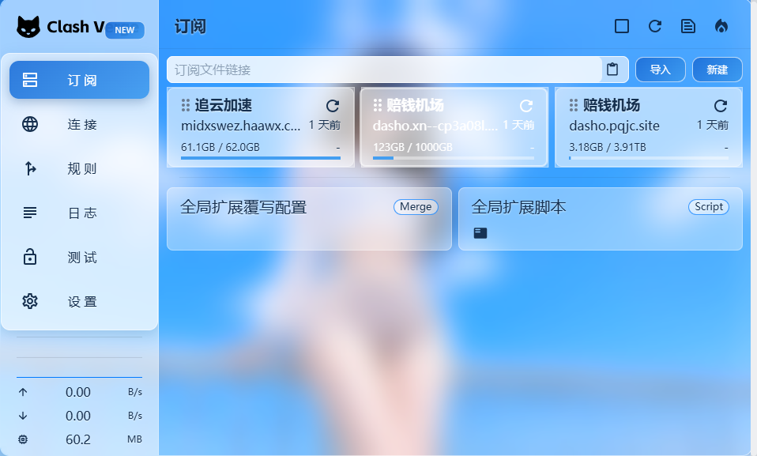

**[查看主题与下载 →](themes/summer-sky/)**

## 🌊 卡通大海 OceanToon

屋顶看海插画 × 玻璃拟态：海天壁纸清晰锐利，陶土橘点缀、深墨蓝字。三档透明度任选，壁纸内嵌、离线可用。

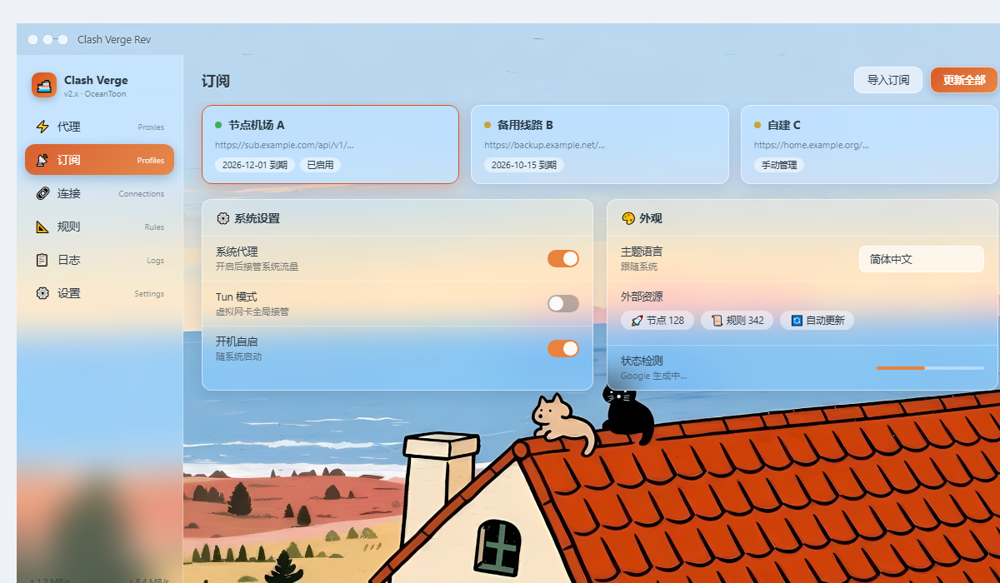

**[查看主题与下载 →](themes/ocean-toon/)**

## 🏫 白墙学园 WhiteCampus

白墙走廊 × 藏青制服，超广角日系构图：墙面大面积留白，主色取制服深蓝。

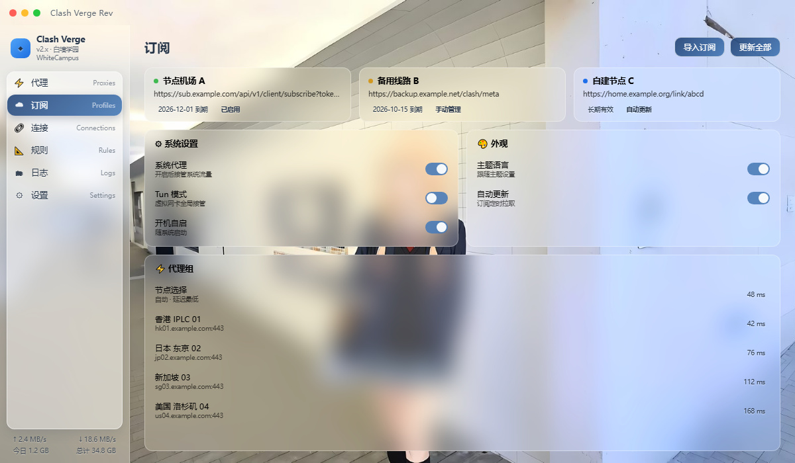

**[查看主题与下载 →](themes/white-campus/)**

## 🪟 灰帘静室 QuietGrey

窗边灰帘 × 白衬衫格裙，室内冷灰调，主色取窗帘的蓝灰。

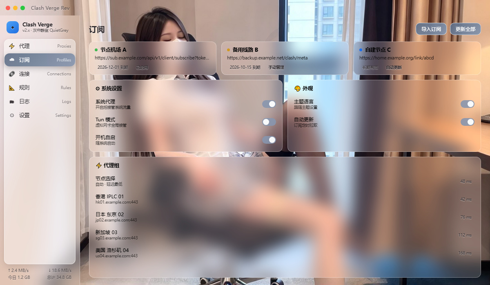

**[查看主题与下载 →](themes/quiet-grey/)**

## 🌸 樱金晴空 SakuraGold

樱粉垂枝 × 秋金黄叶，仰拍晴空插画，主色取花瓣的玫瑰粉。

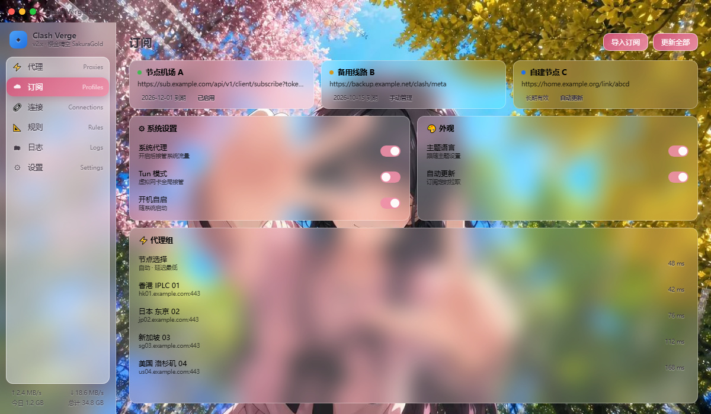

**[查看主题与下载 →](themes/sakura-gold/)**

## 💐 素墙花影 WallBloom

灰水泥墙 × 侧逆光人像 × 紫花束，主色取花束的暗紫。

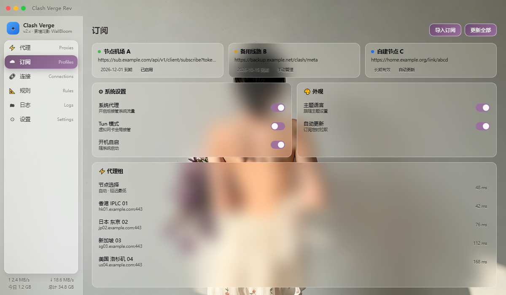

**[查看主题与下载 →](themes/wall-bloom/)**

## 🌫 冷灰烟岚 GreyHaze

冷紫灰墙面 × 黑发与烟雾，仰头冷感插画，主色取雾气的灰紫。

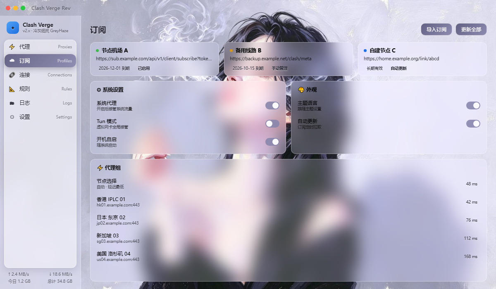

**[查看主题与下载 →](themes/grey-haze/)**

## 🛋 暖棕沙发 CocoaCouch

米色条纹沙发 × 暖棕针织，室内暖光，主色取针织衫的深可可。

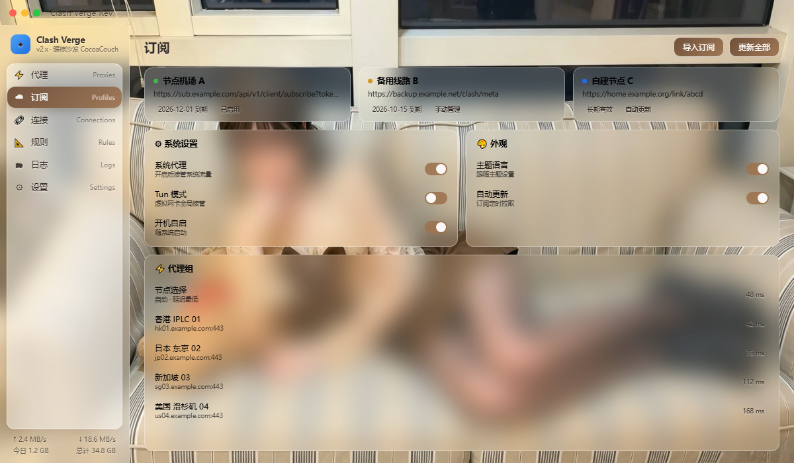

**[查看主题与下载 →](themes/cocoa-couch/)**

## 🏮 灯宵夏祭 LanternFest

夏日祭灯笼串 × 蓝紫黄昏，浴衣少女插画，主色取灯笼的暖橘。

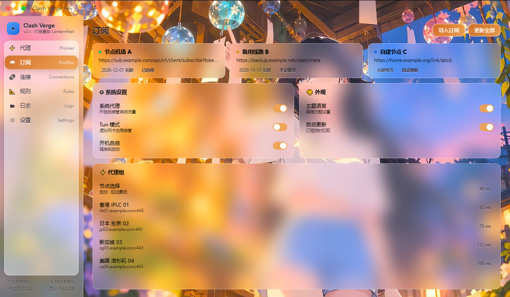

**[查看主题与下载 →](themes/lantern-fest/)**

## 🌹 纱帘红裙 ScarletVeil

白床单 × 红缎吊带裙 × 纱帘逆光，主色取裙身的正红。

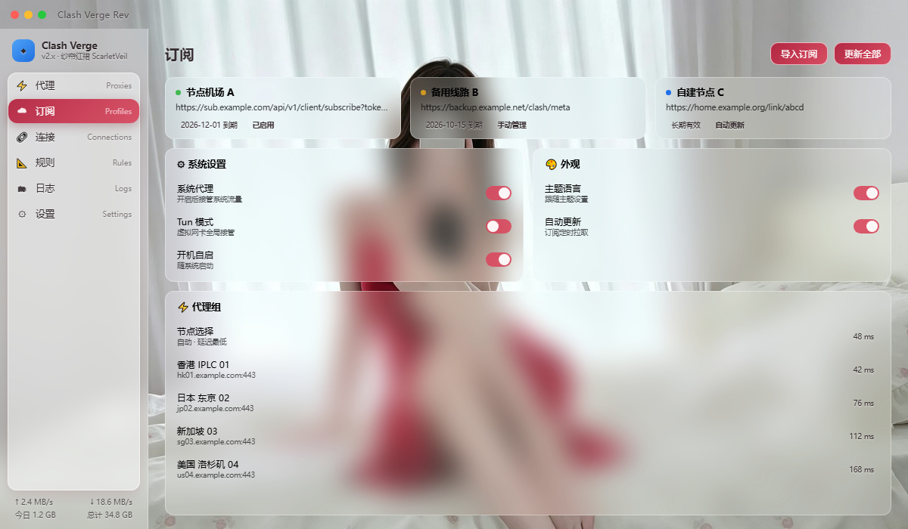

**[查看主题与下载 →](themes/scarlet-veil/)**

## 🪞 镜前衣帽 MirrorCloset

衣帽间对镜自拍 × 原木地板，粉软垫点缀，主色取木地板的浅橡。

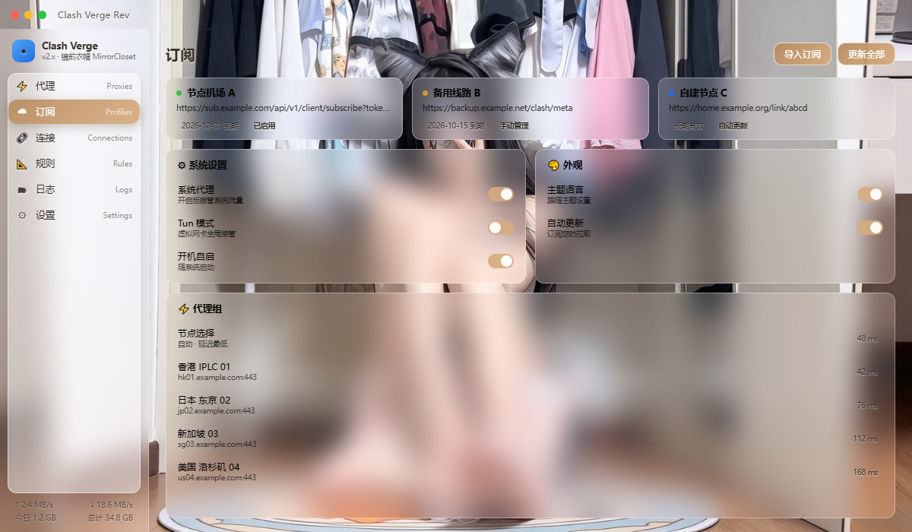

**[查看主题与下载 →](themes/mirror-closet/)**

## 🛏 素床柔光 PaleLinen

白床单俯拍 × 柔光人像，全画面奶白与浅灰，主色取床品的奶咖。

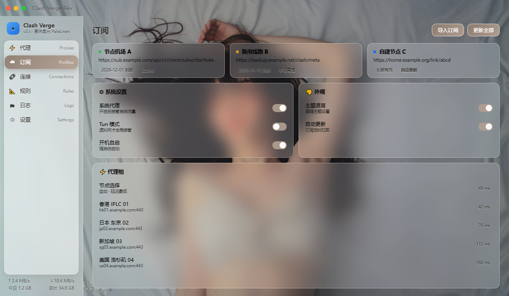

**[查看主题与下载 →](themes/pale-linen/)**

## 🎀 粉绒居家 BlushRoom

粉绒沙发 × 碎花上衣，奶油粉居家场景，主色取沙发的豆沙粉。

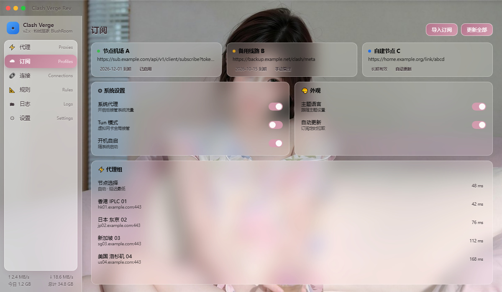

**[查看主题与下载 →](themes/blush-room/)**

## 安装（30 秒）

1. 打开 Clash Verge Rev → **设置** → **外观** → **自定义 CSS**
2. 进入喜欢的主题文件夹，打开想要的档位 CSS，**全选复制，整段粘贴**
3. 立即生效；想换档位，替换粘贴内容即可

## 三档怎么选

| 档位 | 观感 | 适合 |
|---|---|---|
| **ultra** | 纯透明，零模糊 | 壁纸本身干净，想完全看清画面 |
| **high** | 轻微磨砂 | 壁纸细节多，想让卡片后有柔和虚化 |
| **normal** | 磨砂最重、文字最清晰 | 壁纸对比强或长期盯屏 |

## 想用自己的壁纸？

主题壁纸都是 base64 内嵌的（无外链、离线可用）。想换图：准备一张 1600px 宽左右的 JPG，转成 base64，替换 CSS 里 `data:image/jpeg;base64,……` 那一串即可。
想根据自己的图片设计吗？可以联系博主免费帮制作！1795228048@qq.com

## License

[MIT](LICENSE)
